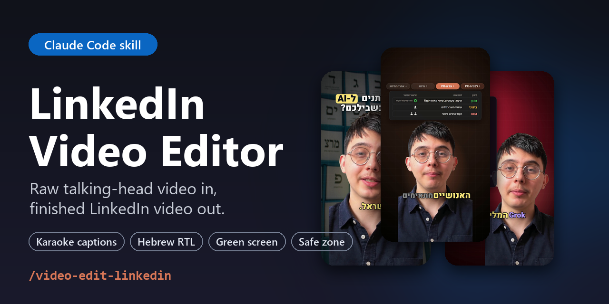
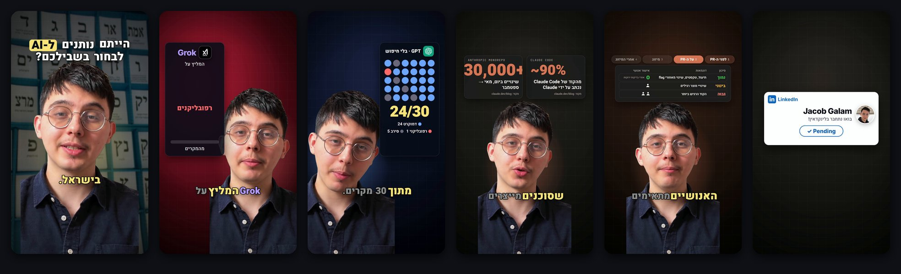
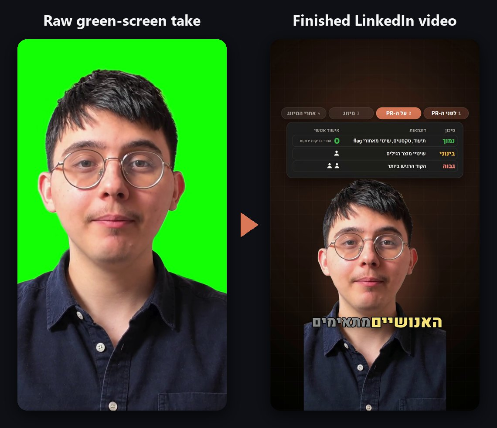
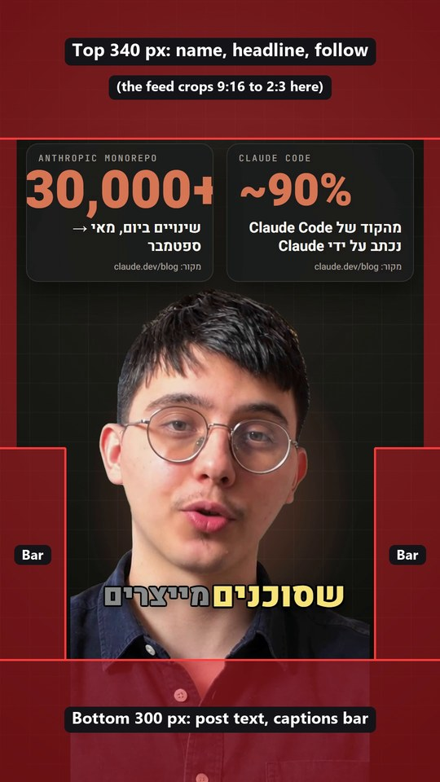

# LinkedIn Video Editor for Claude Code: AI editing skill for talking-head videos

<p align="center">
  
</p>

<p align="center">
  <a href="LICENSE"></a>
  
  
  
  
</p>

**`/video-edit-linkedin` is a [Claude Code](https://claude.com/claude-code) skill that edits LinkedIn videos for you.**
Drop in a raw vertical talking-head video (phone, webcam or green screen, any frame rate). You get back a finished 9:16
LinkedIn video with:

- a hook on the first frame;
- karaoke captions in your exact words;
- motion graphics and real photos;
- sound design;
- a LinkedIn **Connect** card at the end.

Every element is kept inside the LinkedIn safe zone, so nothing important hides under the app's UI.

You never open a video editor. Tell Claude which clip to edit, review the phone copy, and give notes in plain words.
Each round is one re-render.

It works in **English and Hebrew**, including right-to-left (RTL) Hebrew captions.

<p align="center">
  
</p>

## Contents

- [What it does](#what-it-does)
- [Before and after](#before-and-after)
- [The LinkedIn video safe zone](#the-linkedin-video-safe-zone-9x16)
- [Install](#install)
- [Usage](#usage)
- [How it works](#how-it-works)
- [FAQ](#faq)
- [עברית](#עריכת-וידאו-ללינקדאין-עם-claude-code)
- [Credits and license](#credits-and-license)

## What it does

| Feature | What you get |
|---|---|
| **Hook from frame 0** | A bold headline that is readable on the very first frame, which is also the preview frame in the feed. Motion and sound arrive in the first second. |
| **Karaoke captions** | Word-by-word animated subtitles: the spoken word lights up and keywords keep their own colour. With your script, the captions show exactly what you said, not what speech-to-text heard. |
| **Hebrew and RTL** | Hebrew speech-to-text with [ivrit.ai](https://huggingface.co/ivrit-ai)'s Whisper model, right-to-left caption layout, Hebrew fonts (Heebo, Secular One, Suez One), and correct mixed Hebrew/English/number ordering. |
| **Green-screen removal** | Detects a green screen and keys it out in minutes (ffmpeg chroma key with despill). You get a clean cut-out of the speaker over a designed background for each section. With no green screen, AI background removal is used instead. |
| **LinkedIn safe zone** | Every card, word and face is checked against LinkedIn's overlays: the feed header, the post text and the action bar on either side. The build warns about anything that crosses them, and the final render is checked too. |
| **Perfect lip sync, any frame rate** | Frame-locked assembly converts 25 fps (or any rate) phone footage to 30 fps without drift. A cross-correlation sync check must pass before rendering. |
| **Your take stays whole** | Natural pauses are kept by default, so you still sound like you. Pause cutting is available on request. |
| **Motion graphics** | Animated cards, counters, dot grids, toggles, terminal windows, photo cards and words behind your head, rendered from HTML with [HyperFrames](https://github.com/heygen-com/hyperframes) and GSAP. |
| **Head tracking** | Reads where your head is through the take, so side-by-side layouts never put your face under the like/comment bar, and cards never cover your eyes, nose or mouth. |
| **Sound design** | 19 subtle, level-matched sound effects (whooshes, pops, clicks, risers), never louder than your voice. The final mix is mastered to -16 LUFS. |
| **LinkedIn Connect ending** | You leave the frame and a LinkedIn card with your real photo and name plays alone: "Let's connect on LinkedIn!", then Connect turns to Pending. No frozen last frame. |
| **Phone review copy** | A full-quality MP4 for posting and a small 720p copy to review on your phone. |

<p align="center">
  
</p>

## Before and after

One continuous green-screen take, 25 fps, straight from the phone. The same moment in the finished video:

<p align="center">
  
</p>

## The LinkedIn video safe zone (9:16)

LinkedIn shows a 1080×1920 vertical video in two ways:

- **In the feed:** cropped to about 2:3, with your name and headline laid over the top and the post text and controls over the bottom.
- **Full screen:** an action bar (like, comment, repost, send) runs down one side, on the right in the English app and on the left in the Hebrew app.

These are the red lines this skill keeps important content out of. They were measured on screenshots of the LinkedIn app.

<p align="center">
  
</p>

| Zone (1080×1920) | Pixels | What covers it |
|---|---|---|
| Top | y 0 to 340 | Name, headline, Follow; the feed crops the frame to about 2:3 here |
| Bottom | y 1620 to 1920 | Post text, "...more", sound and caption buttons |
| Action bar | x 0 to 160 **and** x 920 to 1080, from y 1100 | Like / comment / repost / send (left in RTL UIs, right in LTR UIs) |
| Side margins | 40 px | Rounded corners and crop |

Your face counts as important content: the skill places the speaker so the eyes-to-chin area stays clear.
`build.py --safe` draws these zones in red on preview snapshots, and `scripts/safe_check.py` paints them on frames
pulled from the final render.

## Install

You need [Claude Code](https://claude.com/claude-code), **ffmpeg**, **Node.js 22+** and **Python 3.10+**. The setup
script checks all of them and prints the exact install command for your OS if something is missing.

**macOS / Linux**

```bash
git clone https://github.com/jacobggman/claude-code-linkedin-video-editor ~/.claude/skills/video-edit-linkedin
```

```bash
python3 ~/.claude/skills/video-edit-linkedin/scripts/setup.py
```

**Windows (PowerShell)**

```powershell
git clone https://github.com/jacobggman/claude-code-linkedin-video-editor "$env:USERPROFILE\.claude\skills\video-edit-linkedin"
```

```powershell
py -3 "$env:USERPROFILE\.claude\skills\video-edit-linkedin\scripts\setup.py"
```

`setup.py` does the following:

- creates the skill's own Python environment (faster-whisper, Pillow);
- pins HyperFrames;
- downloads the sound effects;
- ends with `READY`.

On first use Claude asks for your name, a profile photo (a file path) and your default language, and saves them to
`config.json` (see [`config.example.json`](config.example.json)). That file stays on your machine and is git-ignored.

## Usage

In Claude Code:

```text
/video-edit-linkedin edit ~/Downloads/my-take.mp4 for LinkedIn. Here is my script: ...
```

Or in plain words, in English or Hebrew: *"edit this video for LinkedIn"*, *"ערוך לי את הסרטון"*.

Giving Claude your script is optional but recommended: captions then match your exact words. Add links or sources and
Claude will build cards and screenshots from them and check every number on screen against the source.

Then give notes like a client would ("make the hook bigger", "the code card overflows", "keep my pauses"), and
Claude re-renders. Outputs land in `~/reel-edits/<project>/renders/`:

- `<name>-vN.mp4`: full quality, mastered to -16 LUFS;
- `<name>-vN-phone.mp4`: a 720p copy for review on your phone.

## How it works

| Step | Script | What happens |
|---|---|---|
| 1. Ingest | `scripts/ingest.py` | Probes size and frame rate, makes contact sheets, transcribes with Whisper (ivrit.ai for Hebrew) and maps the silences. |
| 2. Align | `scripts/align.py` | Aligns your script to the transcript word by word, so captions use your words. |
| 3. Cut list | `scripts/make_edl.py` | Keeps the take whole by default; `--cut-pauses` removes dead air. |
| 4. Assemble | `scripts/assemble.py` | Frame-locked 30 fps cut with audio from the exact same seek points. |
| 5. Sync check | `scripts/sync_check.py` | Cross-correlates the audio against the source; must print `SYNC OK` (< 40 ms). |
| 6. Key | `scripts/key.py` / `scripts/cutout.py` | Removes the green screen (or the room, with AI) into a VP9 video with alpha. |
| 7. Head tracking | `scripts/headpos.py` | Measures head position over time to place layouts and behind-head words. |
| 8. Build | `assets/template/build.py` | Generates the HyperFrames composition: layouts, captions, cards, sound, ending; warns on safe-zone violations. |
| 9. Render and master | HyperFrames + ffmpeg | Renders to MP4, then applies loudness normalisation (`loudnorm I=-16`). |
| 10. QA | `scripts/check_cuts.py`, `scripts/safe_check.py` | Checks cuts and safe zones on frames pulled from the final render, then makes the phone copy. |

The template in [`assets/template/build.py`](assets/template/build.py) is a real, finished LinkedIn video (Hebrew,
green screen, 78 s): Claude keeps its machinery and rewrites the content for each new video.
[`references/gotchas.md`](references/gotchas.md) lists every trap already hit once (A/V drift, RTL caption spacing,
lint errors, render fallbacks) so they are not hit twice.

## FAQ

### How do I add karaoke captions to a LinkedIn video automatically?
Install the skill, run `/video-edit-linkedin` in Claude Code and point it at your video. It transcribes the speech
with Whisper, aligns it to your script if you give one, and renders word-by-word captions where the current word is
highlighted.

### What is the safe zone for LinkedIn vertical videos?
For a 1080×1920 video:

- keep text and faces below y 340 and above y 1620;
- stay out of the 160 px on each side below y 1100, where the action bar sits;
- leave a 40 px margin on the sides.

The [table above](#the-linkedin-video-safe-zone-9x16) has the details.

### Does it support Hebrew and right-to-left subtitles?
Yes. Hebrew is a first-class language here:

- ivrit.ai's Hebrew Whisper model for transcription;
- niqqud-safe script alignment;
- RTL karaoke captions with correct handling of English words and numbers inside Hebrew sentences;
- bundled Hebrew fonts;
- an action-bar-aware layout for the Hebrew LinkedIn app.

### Do I need a green screen?
No. With a green screen, keying takes minutes. Without one, the skill falls back to AI background removal (slower on
a CPU) or keeps your real room in a framed tile.

### Will it cut my pauses and make me sound choppy?
Not by default. The whole take is kept, because cutting every pause made a natural speaker sound choppy. Ask for
pause cutting and it will remove dead air, with `--keep` for dramatic beats.

### Does it need a GPU?
No. Everything runs on a laptop CPU: about 11 minutes to render an 80-second video on an 8-core machine.

### Can I use it for Instagram Reels, TikTok or YouTube Shorts?
The output is a standard 1080×1920 MP4, so yes. The layout is tuned to LinkedIn's overlays, though. For Instagram,
see the original [/video-edit](https://github.com/tenfoldmarc/video-edit-skill) skill this one is built on.

### Is it free?
The skill and its tools are free and open source: ffmpeg, HyperFrames, faster-whisper, Google Fonts and Pixabay
sound effects. You need a Claude Code plan to run it.

## עריכת וידאו ללינקדאין עם Claude Code

<div dir="rtl">

סקיל ל־Claude Code שעורך סרטוני טוקינג־הד ללינקדאין, מסרטון גולמי לסרטון מוכן לפרסום:

- **הוק חזק מהפריים הראשון**
- **כתוביות קריוקי בעברית** מימין לשמאל, במילים המדויקות שלכם
- **הסרת מסך ירוק**
- **כרטיסים וגרפיקה מונפשת**
- **אפקטים קוליים עדינים**
- **כרטיס "בואו נתחבר בלינקדאין!"** בסוף הסרטון

כל אלמנט נשאר בתוך האזור הבטוח של לינקדאין, כך ששום דבר חשוב לא מוסתר מתחת לממשק האפליקציה.

התמלול בעברית נעשה עם מודל ה־Whisper של ivrit.ai.

התקנה: שכפלו את הריפו לתיקייה `~/.claude/skills/video-edit-linkedin`, הריצו את `scripts/setup.py`, ואז כתבו ב־Claude Code: `/video-edit-linkedin` ואת שם הקובץ.

</div>

## Credits and license

- Built on [**/video-edit**](https://github.com/tenfoldmarc/video-edit-skill) by **tenfoldmarc** (the Instagram
  reel skill). Parts of this repository are his work, used with credit; see [NOTICE.md](NOTICE.md) for which.
- Rendering: [HyperFrames](https://github.com/heygen-com/hyperframes) (HTML to video) and GSAP.
- Speech-to-text: [faster-whisper](https://github.com/SYSTRAN/faster-whisper), with the Hebrew model by
  [ivrit.ai](https://huggingface.co/ivrit-ai).
- Fonts: Google Fonts, SIL Open Font License.
- Sound effects: Pixabay Content License, downloaded at setup, not stored in this repo.

The LinkedIn additions (safe zone, Hebrew pipeline, green-screen keying, frame-locked assembly, script alignment, head
tracking, LinkedIn card, template) are © Jacob Galam under the [MIT License](LICENSE). LinkedIn is a trademark of
LinkedIn Corporation; this project is not affiliated with or endorsed by LinkedIn.

If this saved you an afternoon in a video editor, a ⭐ helps other creators find it.
